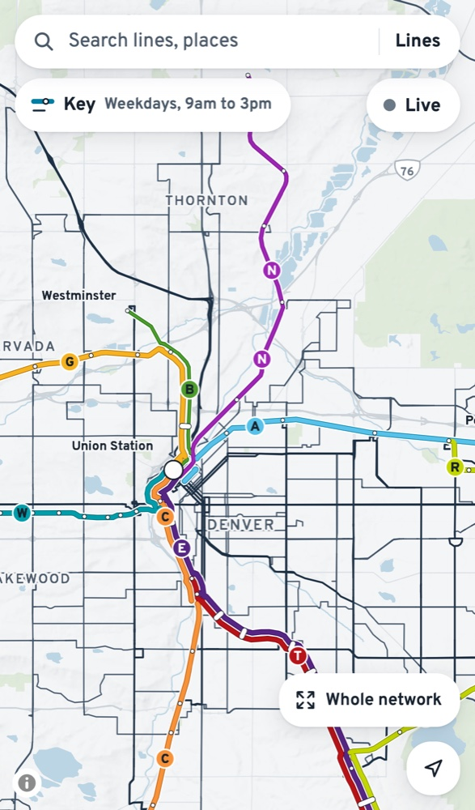
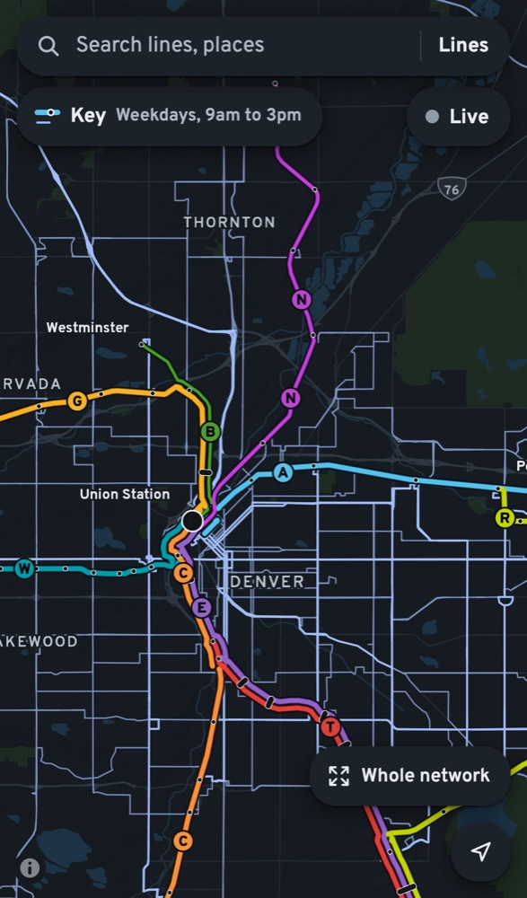

# RTD system map

A map of Denver's transit that opens on the whole network and shows how often
each line comes, not just where it goes. It is for people finding out what
transit they can use at a place, riders on the move, and anyone who needs a
clear picture of where Denver has useful service. A button called Live turns
the same map into right now: what is running, and where the trains and buses
are. It is built for phones first.

**Open it: [rtd-system-map.pages.dev](https://rtd-system-map.pages.dev)**

**How it's built: [the design specification](DESIGN.md)**, also [in the
wiki](https://github.com/datapolitical/rtd-system-map/wiki), one page per
section. Every part of the map follows it: what it shows, how it looks and
behaves, and how it's checked.

This is unofficial. It is built only from RTD's public data and is not
affiliated with RTD.

<p align="center">
  
  &nbsp;
  
</p>

## Run it

You need Node 22 and Cloudflare's Wrangler CLI (`npm install -g wrangler`).

```sh
npm install        # also copies MapLibre and the font into public/vendor/
npm run build      # downloads RTD's public data into public/data/
npm run dev        # serves the site at http://127.0.0.1:8788
npm run dev:live   # the Live relay, on 8789; the site finds it on its own
npm test           # unit tests, plain Node, no browser
npm run check      # headless browser checks (see qa/checks/README.md)
```

`npm run check` needs `npm run dev` running (and `npm run dev:live` for the
Live check), and Playwright's Chromium (`npx playwright install chromium`).

## Design

[DESIGN.md](DESIGN.md) is the source of truth for the objective, audience,
data, map design, interface and milestones. Read it before changing the map,
the interface or the data pipeline (CLAUDE.md says the same). When a decision
changes, update it and add a line to its decision log. Nothing about RTD's
network is written into the code; the build derives it from RTD's data.

## Layout

- `public/`: the static site (plain ES modules in `js/`, no framework).
  `public/data/` and `public/vendor/` are generated and not committed.
- `scripts/`: the build, which fetches, checks and writes the data.
- `live/`: the Live relay, a Cloudflare Durable Object that polls RTD's
  realtime feeds and pushes changes to every open page.
- `refresh/`: a Worker that runs hourly and triggers a rebuild when RTD's
  data has changed.
- `functions/`: Pages Functions that connect the site to the relay.
- `test/`: unit tests, run with `npm test`.
- `qa/`: the QA brief and findings ([qa/BRIEF.md](qa/BRIEF.md)) and the
  headless checks in `qa/checks/`.

## Data

- Lines, stations, Park-n-Rides, bus stops and FlexRide zones come from the
  public ArcGIS layers behind RTD's own system map. They are found from RTD's
  published map on every build.
- Frequency, schedules and rail shapes come from RTD's public GTFS feed,
  `google_transit.zip`.
- Live positions come from RTD's public GTFS-realtime feeds, which need no
  key.
- Street addresses use Photon, an OpenStreetMap geocoder. The basemap uses
  OpenFreeMap's vector tiles.

All of these are public and need no key. Check each provider's terms before
reusing their data.

## How frequency is measured

The map's main number is how often a line comes at midday on a typical
weekday, 9am to 3pm. For each route and direction, the build takes the
typical (median) gap between departures in that window at one place on the
route, and the less frequent direction sets the line's tier: every 15
minutes or better, every 30, or less often. Bus routes are measured stretch
by stretch, so a route that comes every 15 minutes downtown and a few times
a day at its far end is drawn both ways. The typical weekday comes from
RTD's own calendar, skipping holidays and one-off changes. DESIGN.md,
"Frequency and schedules", has the details.

This is a rider's measure, not RTD's service standard, and the two answer
different questions:

- RTD's [Transit Service Policies & Standards](https://cdn.rtd-denver.com/image/upload/v1707247621/service-standards-7-2016_rg0fun.pdf)
  (revised July 2016, the latest version we found) sets *minimum*
  frequencies by type of service and time of day, measured by corridor (all
  routes sharing a segment). Its weekday midday is the same 9am to 3pm. It
  doesn't label any service "frequent": rail and BRT must come at least
  every 15 minutes from 6am to 6pm on weekdays, and local buses at least
  every 30 minutes at rush hours and every 30 or 60 at midday, depending on
  ridership. The map's tier breaks (15, 30, 60 minutes) fall on the
  clock-face frequencies RTD schedules to (section 2.3.4).
- DRCOG's Metro Vision plan counts a stop as high-frequency when it has 96
  or more departures on a typical weekday, an average of one every 15
  minutes across the whole day
  ([data brief](https://drcog.org/sites/default/files/acc/RPD-FL-DATABRIEFFREQUENCY-EN-ACC-24-06-14-V1.pdf)).

So the map can differ from both in two ways:

- **Each route is counted on its own.** Two routes every 30 minutes on the
  same street are drawn as two 30-minute lines, not one 15-minute corridor.
  Whether to combine them is an open question in DESIGN.md.
- **It shows midday.** A route every 15 minutes at noon is drawn as frequent
  even if it comes every 30 minutes in the evening. Its panel also shows
  Saturday and Sunday service and the first and last weekday trips, but not
  yet evening or rush-hour frequency.

## Licence

The code is under the [Apache License 2.0](LICENSE), copyright 2026 Chris
Nicholson (see [NOTICE](NOTICE)). The licence covers this repository's code
and docs. It does not cover RTD's data, which the build downloads and never
commits, or RTD's name and marks, which belong to RTD. The QA baseline
screenshots in `qa/checks/` show RTD's data on OpenFreeMap's basemap
(© OpenMapTiles, © OpenStreetMap contributors).

This project is unofficial and not affiliated with RTD.

Changes you send are taken under the same licence (section 5 of the Apache
License).
